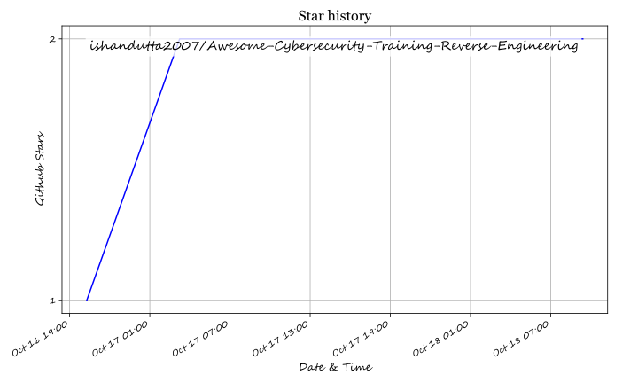

# 🛡️ Awesome Cybersecurity Training & Reverse Engineering ⚡

### 🌐 Curated List of SaaS Cyber Ranges, Interactive Hands-On Labs, Decompilers, and Binary Analysis Toolchains

  
  
  
  
  
  
  

  <strong>Master offensive security, defensive SOC operations, malware triage, and firmware reverse engineering with industry-standard cyber ranges and open-source frameworks.</strong>

---

## 📌 Table of Contents

- [🔍 Sector Overview & Market Dynamics](#-sector-overview--market-dynamics)
- [🏢 SaaS & Hosted Cyber Range Platforms](#-saas--hosted-cyber-range-platforms)
- [💻 Open-Source GitHub Projects](#-open-source-github-projects)
  - [🧰 Additional Ecosystem Resources](#-additional-ecosystem-resources)
- [🤝 How to Contribute](#-how-to-contribute)
- [💖 Support & Community](#-support--community)
- [📈 Star History](#-star-history)
- [⚖️ Disclaimer & Ethical Usage](#️-disclaimer--ethical-usage)

---

## 🔍 Sector Overview & Market Dynamics

The dedicated global cybersecurity training, workforce upskilling, and cyber range market is estimated at **$7.0B–$7.7B** (expanding at **16.8%–18.6% CAGR**, nested inside a macro cybersecurity services ecosystem exceeding $300B). The sector exhibits **moderate fragmentation**: high market concentration anchors the top tier with institutional certification leaders and defense conglomerates (**SANS Institute**, **Mandiant / Google Cloud**, and **Cyberbit**), while vibrant fragmentation persists across mid-market and emerging ed-tech innovators (**Hack The Box**, **TryHackMe**, **SimSpace**, and **Immersive Labs**)—each delivering gamified hands-on labs, AI-driven scenario generators, and digital-twin attack simulations to solve the worldwide cybersecurity talent shortage.

---

## 🏢 SaaS & Hosted Cyber Range Platforms

| Platform | 📊 Company Size (Valuation / Revenue) | 🏷️ Starting Pricing | 🎁 Free Tier / Trial Limits | 📝 Description & Core Focus |
| :--- | :--- | :--- | :--- | :--- |
| **[Mandiant Advantage](https://www.mandiant.com/advantage)** | **$5.4B** (Acquired by Google; ~$483M LTM revenue) | Custom enterprise starting ~$200,000/yr (or ~$650/hr for discrete assessment units) | Free Community Threat Intelligence tier (limited threat actor profiles, IOCs, and CVE views) plus 14-day higher-tier feature evaluation | Comprehensive threat intelligence, attack surface management, and Mandiant Academy / ThreatSpace cyber range simulations. |
| **[SANS OnDemand](https://www.sans.org/)** | **~$360M** est. annual revenue (Privately held, employee-owned) | Starting **$5,000–$7,000** per self-paced course (includes 4 months / 120 days access) | No free full-course tier; provides 55+ free course preview modules/excerpts (SEC275, SEC301, SEC401, FOR500) | The premier gold-standard cybersecurity certification and training catalog, with GIAC exam pathways and NetWars cyber challenges. |
| **[Immersive Labs](https://www.immersivelabs.com/)** | **$250M–$500M** valuation (~$90M est. annual revenue; $180M+ funded) | Annual contracts starting at **~$4,820/yr** (median enterprise deployments ~$44,250/yr) | 3-month (90 days) free enterprise evaluation trial (free access to selected entry paths via Cyber Million program) | People-centric cyber resilience with AI-powered Lab Builder, practical organization tool validations, and crisis drills. |
| **[Hack The Box Enterprise](https://www.hackthebox.com/)** | **$250M–$500M** valuation (~$10M–$50M ARR; $70M+ funded) | Individual VIP+ at **$25/mo** ($223/yr); Academy tiers start at **$10/mo**; Team Build tier starts at **$250/seat/mo** | Permanent free tier with limited active machines and 24 hours/mo Pwnbox access; Dedicated enterprise labs offer demo trial on request | Dedicated corporate labs, customizable machine uploads, isolated attack surfaces, MITRE ATT&CK alignment, and talent recruiting. |
| **[SimSpace](https://simspace.com/)** | **~$100M+** valuation ($50M+ ARR trajectory; $109M+ funded) | Enterprise cyber ranges starting at **~$25,000/yr** (modular use-case based pricing) | No self-serve trial; offers custom proof-of-concept / guided live-fire range demo trial upon sales qualification | High-fidelity digital-twin cyber ranges with L1–L3 attack emulation, ARIA automated range generation, and live-fire defense drills. |
| **[Cybrary for Business](https://www.cybrary.it/)** | **~$100M** valuation ($52M+ funded) | Teams plan starting at **$79/mo** (billed annually) | 7-day free trial for individual/team access; permanent free tier with basic baseline assessments and limited course catalog | Skill gap baselining, Cyber Risk Impact scoring, CVE threat actor simulations (APT35, APT41), and custom learning paths. |
| **[RangeForce (Cyberbit)](https://www.cyberbit.com/rangeforce/)** | **~$100M+** combined valuation ($40M+ VC prior to Sep 2025 acquisition by Cyberbit) | Entry enterprise packages starting at **~$3,000–$5,000/yr** | Permanent free edition with solo hands-on skills labs and introductory threat mitigation modules | Live-fire SOC team readiness exercises (host of NATO Locked Shields), solo cloud labs, and blue team breach scenarios. |
| **[OffSec Proving Grounds](https://www.offsec.com/products/proving-grounds/)** | **~$20M–$50M** est. revenue (Acquired by Leeds Equity Partners, 2024) | PG Practice at **$19/mo** or **$199/yr**; Learn One at **$2,599/yr** | PG Play permanent free tier with 50+ VulnHub machines capped at 3 daily hours (1 concurrent machine) | Realistic hands-on penetration testing labs, retired OSCP+ exam machines, and in-browser Kali Linux attack stations. |
| **[TryHackMe Business](https://tryhackme.com/)** | **~$10M+** ARR (Self-sustained/bootstrapped) | Individual Premium starts at **$14/mo** ($126/yr); EDU licenses at **$30/seat/mo**; Business custom quotes (min. 5 seats) | Permanent free account with access to hundreds of free introductory rooms and 1 hour/day in-browser AttackBox access | Gamified cybersecurity training with guided paths, custom CTF builders, cloud labs, and team progress analytics. |
| **[Pentester Academy](https://www.pentesteracademy.com/)** | **Sub-$20M** (Acquired by INE in 2021) | Annual subscription starting at **$249/yr**; Bootcamp cohorts from **$299–$499** | Free community taster labs (90+ browser-based terminal labs via AttackDefense / INE Skill Dive) | On-demand bootcamps and 2,000+ browser-based labs covering OWASP Top 10, Active Directory attacks, and x86/x64 assembly. |

---

## 💻 Open-Source GitHub Projects

| Project | ⭐ GitHub_Stars | 🎯 Focus Area | 📖 Description |
| :--- | :--- | :--- | :--- |
| **[x64dbg](https://github.com/x64dbg/x64dbg)** |  | Dynamic Analysis & Debugging | An open-source x64/x32 debugger for Windows. Features an intuitive Qt GUI, TitanEngine abstraction, scriptable automation, and an extensive plugin ecosystem. |
| **[Ghidra](https://github.com/NationalSecurityAgency/ghidra)** |  | Static Analysis & Decompilation | NSA's software reverse engineering framework (Apache-2.0). The industry-standard open-source RE suite including disassembler, decompiler, graphing, and Java/Python scripting. |
| **[radare2](https://github.com/radareorg/radare2)** |  | Multi-Architecture RE Framework | Portable reverse engineering framework and commandline toolset. Supports disassembly, debugging, binary patching, and forensics across dozens of architectures and OSes. |
| **[Cutter](https://github.com/rizinorg/cutter)** |  | GUI for Reverse Engineering | Free and open-source RE platform powered by Rizin. Features an advanced decompiler (Ghidra decompiler integration), graph views, hex editor, and Python plugin support. |
| **[pwntools](https://github.com/Gallopsled/pwntools)** |  | CTF & Exploit Development | CTF framework and exploit development library in Python. Designed for rapid prototyping, binary patching, ELF manipulation, ROP chain generation, and remote socket interaction. |
| **[Atomic Red Team](https://github.com/redcanaryco/atomic-red-team)** |  | Adversary Emulation & Cyber Range | Library of simple, open-source automated tests mapped directly to the MITRE ATT&CK framework, allowing security teams to test controls and train defenders against real tactics. |
| **[pwndbg](https://github.com/pwndbg/pwndbg)** |  | Exploit Engineering & GDB Plug-in | Python GDB plug-in making debugging with GDB intuitive for reverse engineers and exploit developers, with heap introspection, context displays, and memory analysis. |
| **[FLARE VM](https://github.com/mandiant/flare-vm)** |  | Malware Analysis Ecosystem | Fully customizable, Windows-based security distribution for malware analysis, reverse engineering, and incident response created and maintained by Mandiant. |
| **[angr](https://github.com/angr/angr)** |  | Symbolic Execution & Binary Analysis | Python framework for analyzing binaries. Combines static and dynamic symbolic execution (concolic analysis) for automated vulnerability discovery and deobfuscation. |
| **[GEF](https://github.com/hugsy/gef)** |  | GDB Exploit Framework | Multi-architecture GDB extension designed for dynamic binary analysis, exploit writers, and reverse engineers with visual memory inspection and architecture registers. |
| **[Commando VM](https://github.com/mandiant/commando-vm)** |  | Red Team & Penetration Testing | Windows-based penetration testing virtual machine distribution using Chocolatey packages, delivering a complete penetration testing and red teaming environment. |
| **[CALDERA](https://github.com/mitre/caldera)** |  | Automated Cyber Range & Emulation | Scalable automated adversary emulation platform built on the MITRE ATT&CK framework by MITRE, designed for autonomous blue team training and security testing. |
| **[CTFd](https://github.com/CTFd/CTFd)** |  | Cyber Training & CTF Platform | The leading open-source capture-the-flag platform. Easy to deploy, highly customizable with plugins and themes, used globally for cybersecurity training competitions. |
| **[capa](https://github.com/mandiant/capa)** |  | Capability Detection & Triage | Mandiant's open-source tool that identifies capabilities in executable files using community-curated rules, automatically telling you what a program can do (e.g., inject code, steal credentials). |
| **[Cuckoo Sandbox](https://github.com/cuckoosandbox/cuckoo)** |  | Automated Malware Sandbox | Leading automated malware analysis system. Throws suspicious files into isolated VM sandboxes and produces comprehensive behavioral execution traces. |
| **[Volatility 3](https://github.com/volatilityfoundation/volatility3)** |  | Memory Forensics & Incident Response | The world's most widely used memory forensics framework for extracting digital artifacts from volatile RAM memory samples of Windows, Linux, and macOS systems. |
| **[Rizin](https://github.com/rizinorg/rizin)** |  | Binary Analysis Engine | UNIX-like reverse engineering framework and commandline toolset, focused on usability, clean APIs, and modular disassembler/debugger integration. |
| **[Autopsy](https://github.com/sleuthkit/autopsy)** |  | Digital Forensics Training Platform | Premier end-to-end digital forensics platform and graphical interface to The Sleuth Kit. Used by law enforcement, military, and corporate examiners worldwide. |
| **[mcsema](https://github.com/trailofbits/mcsema)** |  | Binary Translation & Lifting | Framework for lifting machine code to LLVM bitcode. Translates x86, amd64, and AArch64 program binaries into LLVM IR for binary analysis and transformation. |
| **[Manalyze](https://github.com/JusticeRage/Manalyze)** |  | Static PE Malware Analyzer | Static code analyzer for PE executables that extracts strings, finds cryptographic algorithms, detects packers, and queries ClamAV and VirusTotal. |
| **[SentinelForge CTF](https://github.com/chadeckles/sentinelforgectf)** |  | Cloud & DevSecOps CTF | Self-hosted CTF platform focused on cloud security (Azure misconfigurations), container escapes, IaC flaws, and DevSecOps challenges with 5-minute Docker Compose setup. |
| **[PyX64Dbg](https://github.com/yoav-shamay/pyx64dbg)** |  | Pythonic Debugger for Linux | Python-based debugger for x86-64 Linux binaries using `ptrace` and `/proc`. Features a clean Python automation API, PySide6 GUI, and IPython CLI. |

### 🧰 Additional Ecosystem Resources

- **[Übungszentrum Netzverteidigung 2.0 (BSI)](https://opencode.de)** — German Federal Office for Information Security (BSI) open-source cybersecurity training system and CAVE IaC range engine published on **OpenCode**.
- **[VulnHub](https://www.vulnhub.com/)** — Premier catalog of community-created vulnerable machines and images for hands-on offensive/defensive practice.

---

## 🤝 How to Contribute

Contributions are warmly welcome! Help make this the most comprehensive, accurate, and community-driven directory:

1. 🍴 **Fork the repo**.
2. 🌿 **Create a feature branch** (`git checkout -b feature/add-new-tool`).
3. 📝 **Add/edit entries in `README.md`** (follow the table layout, including pricing, free tier limits, and stargazer links).
4. 🚀 **Submit a Pull Request** with a brief summary of additions or corrections.

---

## 💖 Support & Community

Thank you so much for exploring and supporting this curated cybersecurity resource! If this repository has helped your training, research, or reverse engineering workflows, please consider:

- ⭐ **Starring this repository** to help others discover it on GitHub.
- 🍴 **Forking and sharing** it with your security team, colleagues, or study groups.
- ☕ **Supporting ongoing maintenance and research**: You can sponsor or buy a coffee via the [GitHub Sponsors Dashboard](https://github.com/sponsors/ishandutta2007).

Your backing ensures these listings remain updated with the latest tools, pricing models, and security landscape shifts!

---

## 📈 Star History

---

## ⚖️ Disclaimer & Ethical Usage

- This is a **community-curated** list — not exhaustive and not an official corporate endorsement.
- Cybersecurity training and reverse engineering tools must be used **lawfully, authorizedly, and ethically**. Always verify permissions before testing third-party software, infrastructures, or binaries.
- **Open-source reverse engineering is production-grade:** Tools like Ghidra, x64dbg, Rizin/Cutter, and radare2 provide industry-grade disassembly, decompilation, and debugging capabilities.
- **Training environments containing live exploits, malware samples, or vulnerable hosts must be strictly network-isolated and air-gapped from production environments.**

---

  Made with ❤️ for security analysts, penetration testers, reverse engineers, and blue teams worldwide.

## ⭐ Star History

<a href="https://star-history.com/#ishandutta2007/Awesome-Cybersecurity-Training-Reverse-Engineering&Timeline" align="center">
  <picture>
    <source media="(prefers-color-scheme: dark)" srcset="assets/ishandutta2007_Awesome-Cybersecurity-Training-Reverse-Engineering_growth.svg">
    
  </picture>
</a>
